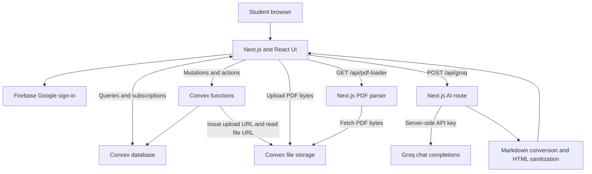
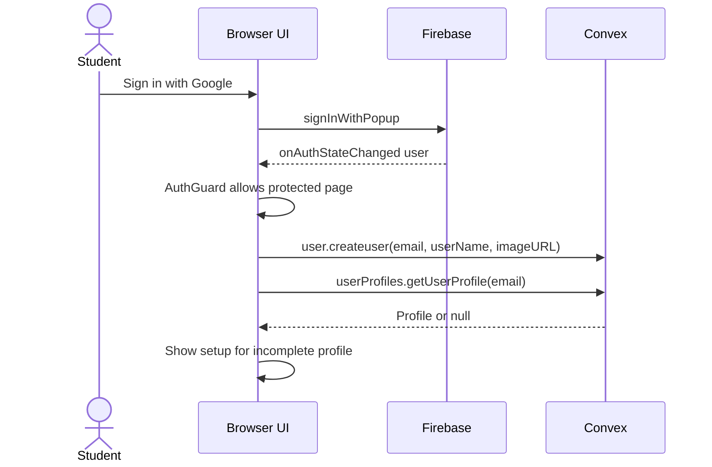

# Architecture

## Service map

## Main layers

- **Presentation:** `app/` pages, dashboard components, and reusable `components/ui/` controls.
- **State:** React component state, Firebase auth context, and Convex reactive queries; no separate global state store.
- **Next.js server:** PDF parsing and Groq proxy routes under `app/api/`.
- **Convex backend:** schema, profile/PYQ/file/note functions, and document ingestion/search actions.
- **Storage:** PDF bytes in Convex file storage; file metadata, text chunks, and notes in database tables.
- **UI stack:** Tailwind CSS, Radix/shadcn components, Lucide icons, and Sonner notifications.

## Routes

- `/` — landing page.
- `/sign-in`, `/sign-up` — Google sign-in entry points.
- `/dashboard` — overview, counts, recent PDFs, PYQs, and study-partner suggestions.
- `/dashboard/workspace` — personal PDF collection.
- `/dashboard/pyqs` — shared question-paper library.
- `/dashboard/community` — student discovery and skill-based recommendations.
- `/dashboard/profile` — profile details and editing.
- `/workspace/[fileId]` — notes editor and PDF viewer; mobile pane switching.
- `/api/pdf-loader`, `/api/groq` — server endpoints used by the PDF workflow.

## Authentication lifecycle

- `lib/GoogleAuthContext.js` adapts Firebase user fields to the UI's user shape.
- `app/layout.jsx` installs the auth provider, Convex provider, and toast container.
- `app/Providere.js` holds one shared `ConvexReactClient`.
- Dashboard layout wraps content with `AuthGuard`, `UserInitializer`, and `ProfileChecker`.
- Workspace layout uses `AuthGuard`; middleware currently permits requests through.
- **Current trust boundary:** Firebase identity is not passed to Convex as a verified backend identity; inspected functions accept caller-supplied email/file IDs without ownership checks.

## Feature behavior

- **Community:** completed profiles are discoverable; recommendations rank students by the number of matching skills, case-insensitively.
- **Connections:** LinkedIn links; no internal chat or friend-request table.
- **PYQs:** shared metadata includes semester and subject; uploads use the storage pipeline without RAG ingestion.
- **Workspace:** Tiptap notes beside a PDF iframe; explicit Save and keyboard shortcut; AI insertion also saves notes.
- **Exports:** saved notes are printed through the browser for PDF or converted with `html-docx-js` for DOCX.

## Source entry points

- [Root layout](../app/layout.jsx), [dashboard layout](../app/dashboard/layout.js), [workspace page](../app/workspace/%5BfileId%5D/page.js).
- [Firebase context](../lib/GoogleAuthContext.js), [Convex provider](../app/Providere.js), [route guard](../components/ui/AuthGuard.jsx).
