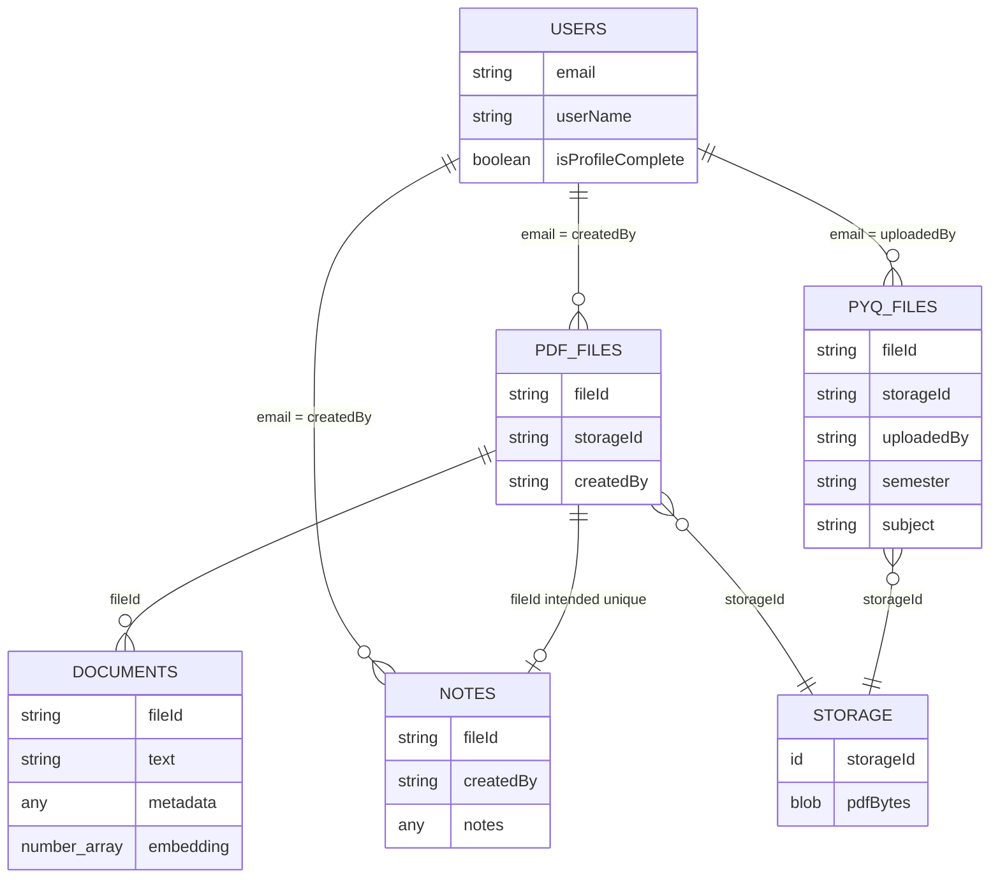

# Database schema

- **Source of truth:** [convex/schema.js](../convex/schema.js).
- **System fields:** Convex adds `_id` and `_creationTime` to every record.
- **Notation:** `?` means optional; `any` is a Convex value with no narrower schema validator.
- **IDs:** application `fileId` is a UUID string; it differs from a Convex record `_id` and storage `storageId`.

## Logical relationships

- Relationships above are application conventions, not enforced foreign keys.
- `STORAGE` represents Convex's storage service, not a sixth application table.
- One notes record per `fileId` is the upsert convention; the schema has no uniqueness constraint.

## `users`

- **Required strings:** `email`, `imageURL`, `userName`.
- **Optional strings:** `name?`, `department?`, `batch?`, `linkedinProfile?`, `bio?`.
- **Other optional fields:** `expertise?: string[]`, `isProfileComplete?: boolean`, `joinedAt?: number`.
- **Behavior:** create once per email through a lookup; profile is complete when name, department, and batch are truthy.
- **Indexes:** no custom indexes; email/profile queries use filters.

## `pdfFiles`

- **Required strings:** `fileId`, `storageId`, `fileName`, `fileUrl`, `createdBy`.
- **Optional strings:** `semester?`, `subject?`; private uploads currently send empty strings.
- **Meaning:** workspace PDF metadata; `createdBy` stores an email.
- **Indexes:** no custom indexes; queries filter by creator or `fileId`.

## `documents`

- **Required:** `text: string`, `metadata: any`.
- **Optional:** `fileId?: string`, `embedding?: number[]`.
- **New chunk shape:** `{ text, fileId, metadata: { fileId } }`.
- **Legacy shape:** older chunks can have `embedding` and `metadata.fileId` without top-level `fileId`.
- **Active index:** `by_fileId` on `fileId`; fetches chunks for one PDF.
- **Retained vector index:** `byEmbedding`, field `embedding`, dimension **3072**; unused by current retrieval.
- **Compatibility:** search falls back to filtering `metadata.fileId` when indexed chunks are absent.

## `notes`

- **Required strings:** `fileId`, `createdBy`.
- **Required content:** `notes: any`; editor currently writes an HTML string.
- **Behavior:** `AddNotes` inserts or updates the first matching `fileId`; `GetNotes` returns its content.
- **Indexes:** no custom indexes.

## `pyqFiles`

- **Required strings:** `fileId`, `storageId`, `fileName`, `fileUrl`, `semester`, `subject`, `uploadedBy`.
- **Required number:** `uploadedAt` — milliseconds from `Date.now()`.
- **Meaning:** shared question papers; `uploadedBy` stores an email.
- **Indexes:** no custom indexes; filtering is by semester/subject, and listings use descending creation order.

## Consistency details

- PDF bytes, metadata insertion, parsing, and chunk ingestion are separate operations; a later failure can leave earlier records/files present.
- Re-ingestion replaces indexed chunks for that PDF; legacy records remain stored but are ignored when new chunks exist.
- No application-level cascade deletion or relational uniqueness enforcement is implemented.
