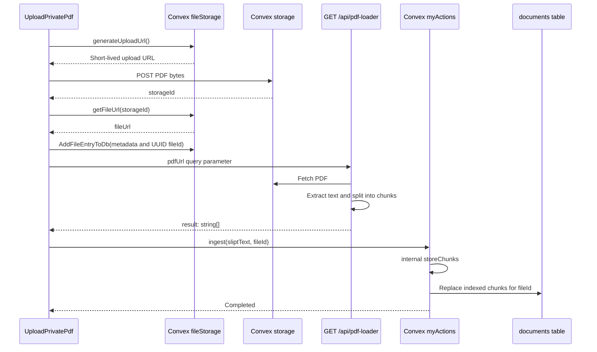
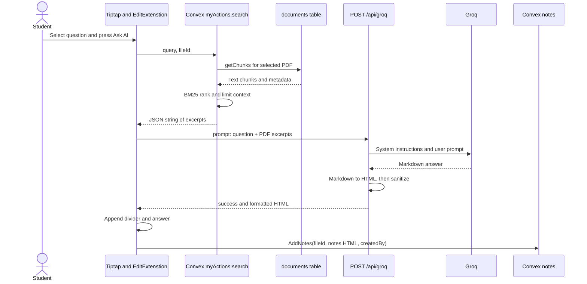

# RAG and AI calls

- **RAG:** retrieve PDF excerpts, attach them to a question, and generate a grounded answer.
- **Current implementation:** document-scoped BM25 keyword retrieval + Groq generation.
- **New PDFs:** no embedding API calls; LangChain is used for PDF loading and text splitting.

## 1. Ingest a PDF

- **Upload component:** [UploadPrivatePdf.js](../app/dashboard/_components/UploadPrivatePdf.js).
- **Picker:** PDF MIME type and **20 MB** maximum checked in the browser.
- **Parser:** [pdf-loader/route.js](../app/api/pdf-loader/route.js), `WebPDFLoader`.
- **Splitter:** `RecursiveCharacterTextSplitter`; **1,800 characters**, **250-character overlap**.
- **Return:** `{ result: ["chunk text", ...] }`.
- **Ingestion contract:** `myActions.ingest({ sliptText: string[], fileId: string })`; `sliptText` is the existing argument spelling.
- **Storage operation:** internal `storeChunks` deletes previous indexed chunks, skips whitespace-only chunks, then inserts text and metadata.

## 2. Answer a question

## 3. Retrieval settings

- **Entry:** `myActions.search({ query: string, fileId: string })`.
- **Read:** internal `getChunks` uses `documents.by_fileId`; legacy fallback uses `metadata.fileId`.
- **Ranker:** [lib/pdfRetrieval.js](../lib/pdfRetrieval.js).
- **Tokenization:** lowercase Unicode letters/numbers; remove a small English stopword list.
- **Score:** BM25 using term frequency, inverse document frequency, and length normalization; `k1 = 1.2`, `b = 0.75`.
- **Limits:** at most **12 excerpts** and **24,000 characters** of chunk text; prompt separators are additional.
- **No matching words:** sample chunks across the PDF.
- **Response:** JSON-encoded `[{ pageContent, metadata }, ...]`.

## 4. Groq request

- **App endpoint:** `POST /api/groq`, body `{ "prompt": "Question: ... PDF excerpts: ..." }`.
- **Provider endpoint:** `POST https://api.groq.com/openai/v1/chat/completions`.
- **Authorization:** server reads `GROQ_API_KEY`; browser never receives the key.
- **Model:** `GROQ_MODEL` or default `qwen/qwen3.8-27b` from [AIModel.js](../configs/AIModel.js).
- **Messages:** one study-assistant system prompt + one user prompt containing the question and excerpts.
- **Parameters:** temperature **0.2**; maximum completion tokens **4096**; timeout **45 seconds**.
- **Validation:** nonempty string prompt, at most **60,000 characters**.
- **Success:** `{ success: true, response: "
Formatted answer
" }`.
- **Errors:** `400` invalid input; `503` missing key; `429` provider rate limit; `502` provider/network/empty-answer failures.
- **History:** each request is independent; the client sends `history: []`, which the route ignores.

## 5. Rendering and limits

- [formatAiAnswer.js](../lib/formatAiAnswer.js) uses `markdown-it`, followed by `sanitize-html`.
- Preserves paragraphs, headings, bold/emphasis, lists, quotes, and code; removes attributes and unsupported tags.
- Presentation-only HTML/Markdown fences are unwrapped; programming code fences remain code blocks.
- Tiptap appends the answer through an editor transaction; AI insertion is saved automatically.
- No OCR, reranker, semantic embeddings, page citations, conversation memory, or streaming is implemented.
- Keyword retrieval can miss paraphrases; PDF text is concatenated before splitting, so chunks do not retain page numbers.
- Context filtering by `fileId` scopes retrieval; it does not verify that the caller owns the file.
